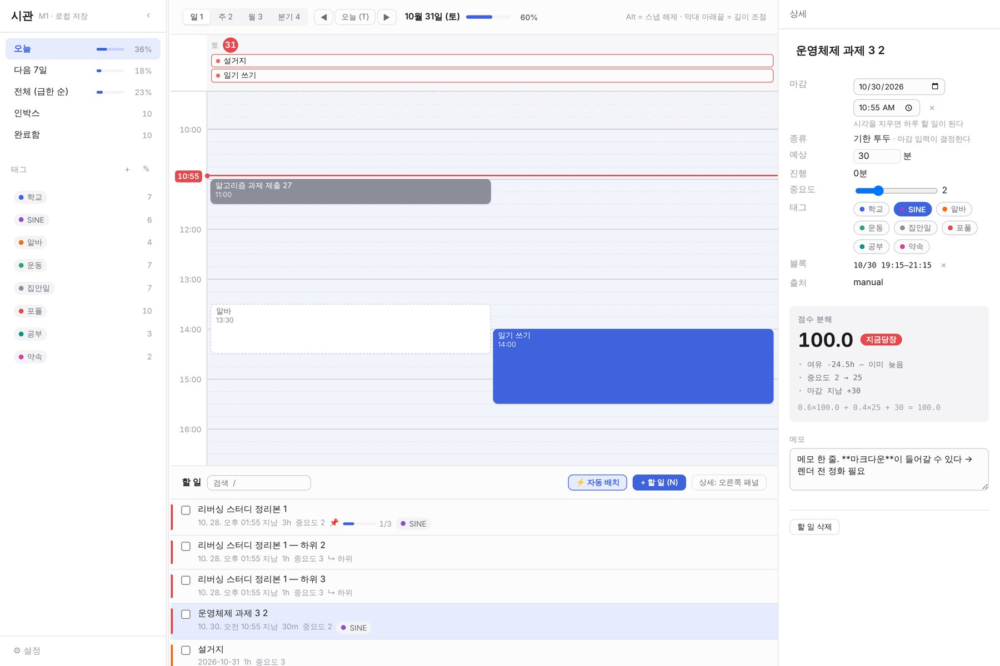
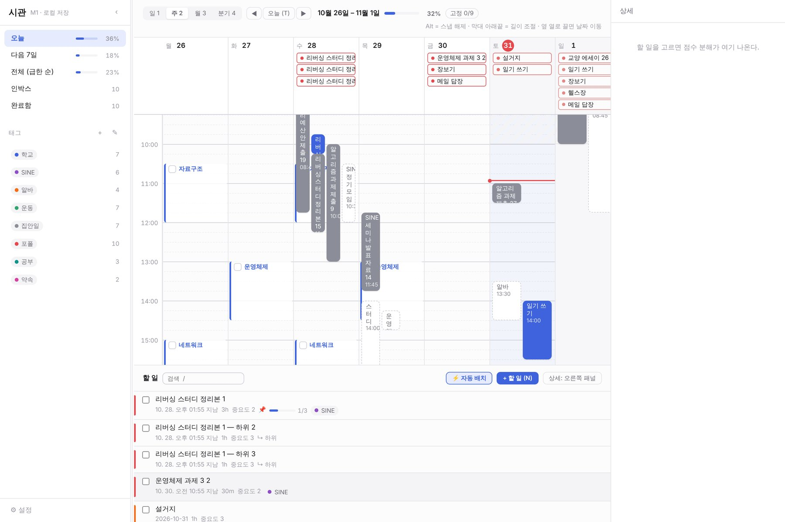
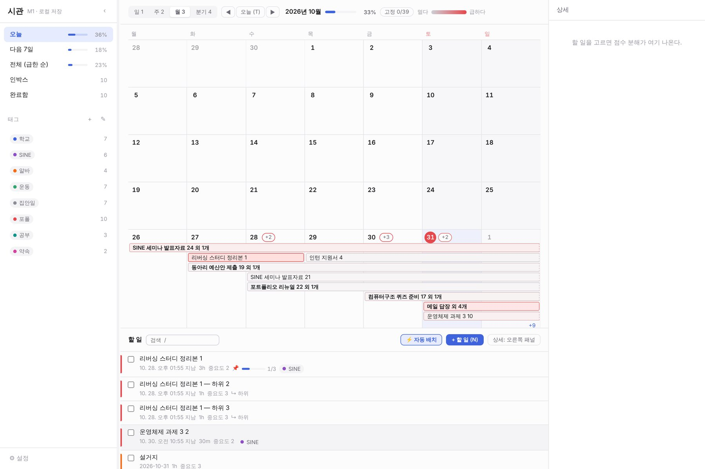
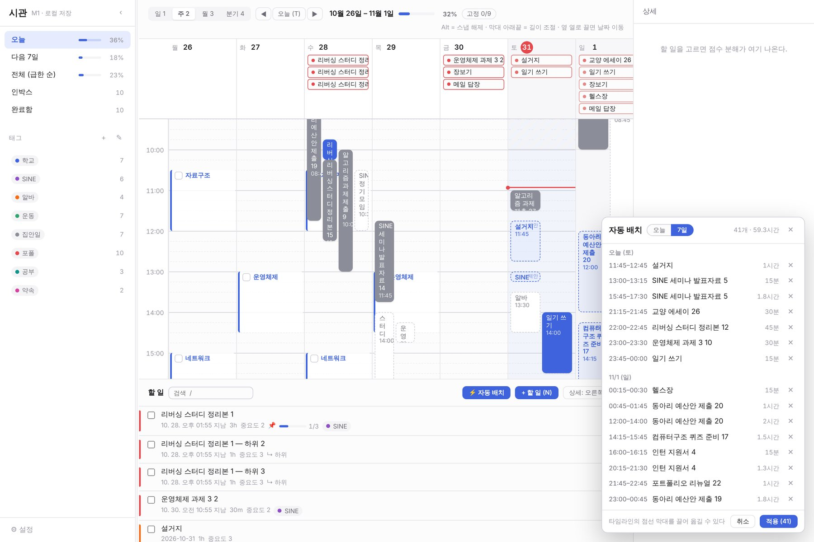
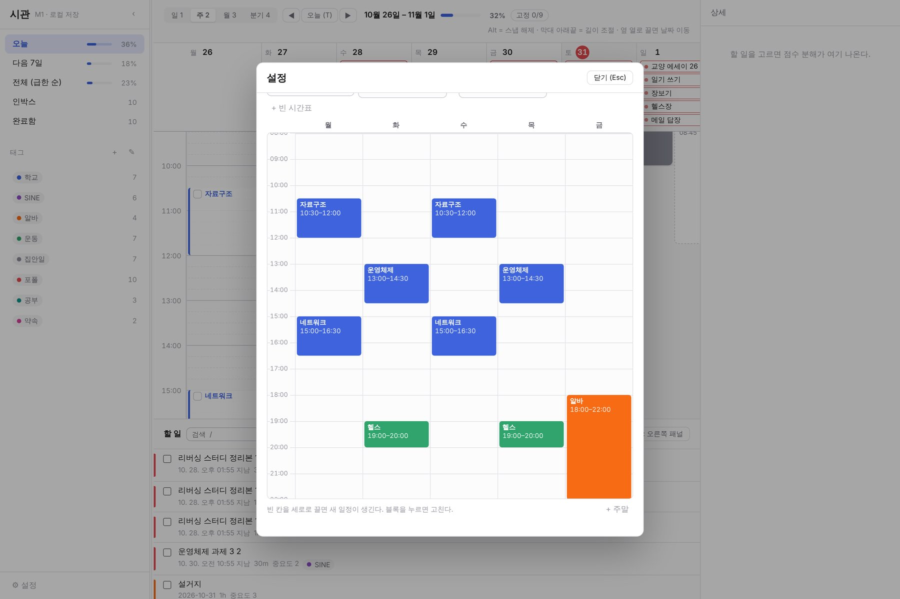
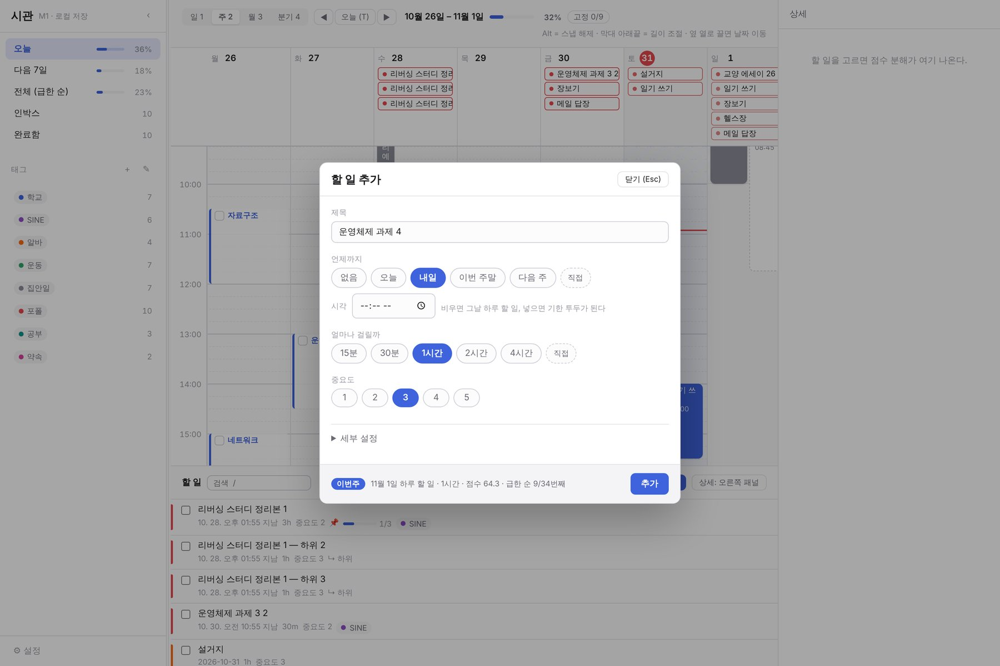
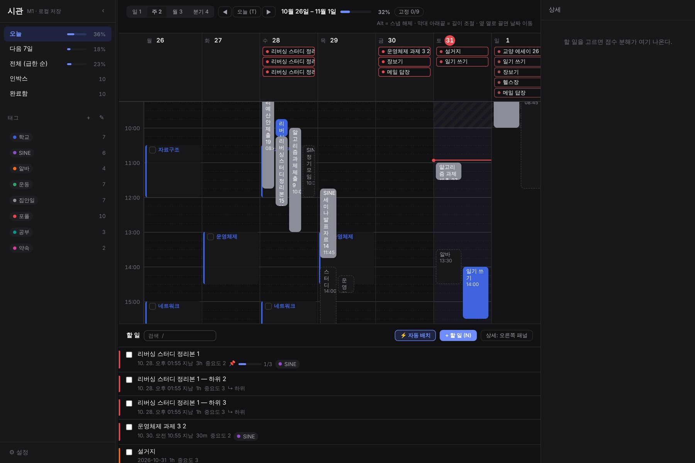

# 시관 (sigwan) — 26 Fall 중간 점검

> 시간 관리 앱 · 웹 + 안드로이드<br>
> 레포지토리: https://github.com/iyaho/sigwan<br>
> 상세 설계: [`docs/설계명세.md`](./설계명세.md) (v0.11)<br>
> 기준일: 2026-11-01

---

## 1. 프로젝트 동기와 목적

### 동기
- 할 일 앱은 **"무엇을"**만, 캘린더는 **"언제"**만 다룬다. 해야 할 일을 실제 시간에 배치하려면 두 앱을 오가야 한다
- 할 일이 쌓이면 **무엇부터 할지 정하는 일** 자체가 일이 된다. 마감만 보고 고르면 "사흘 남았지만 20시간 걸리는 일"을 놓친다
- 수업·알바처럼 매주 고정된 시간과 수면 시간을 빼고 나면 실제로 쓸 수 있는 시간이 얼마인지 한눈에 보이지 않는다

### 목적
1. **할 일(Task)과 시간 블록(Block)을 분리**해서 한 화면에 둔다. 할 일을 타임라인에 끌어다 놓으면 블록이 생긴다
2. **급한 순 자동 정렬** — 마감까지 남은 시간이 아니라 **여유(남은 시간 − 남은 작업량)**와 중요도로 점수를 매긴다
3. **고정 일정·수면을 피해 자동 배치** — 비어 있는 시간에 급한 순으로 할 일을 채워 넣는 제안을 만든다
4. **오프라인 우선** — 네트워크 없이 완전히 동작하고, 서버는 기기 간 동기화에만 쓴다
5. 웹(PC)과 안드로이드(폰 + 홈 화면 위젯)에서 **같은 규칙으로 같은 답**을 낸다

---

## 2. 참여 인원과 역할

5명. 레이어(프론트/백엔드)가 아니라 **모듈 단위**로 나눈다 — 한 사람이 빠져도 나머지가 멈추지 않게. 모듈마다 부 오너를 둔다.

| 이름 | 역할 | 맡은 부분 |
|---|---|---|
| **이진호** | 팀장 · 코어·동기화 | 설계, 통합·리뷰. 공통 규칙(`packages/core`), 로컬 DB와 동기화 클라이언트 |
| **권수한** | 백엔드 · 인증 | Supabase 스키마, 계정별 데이터 접근 정책(RLS), 아이디 로그인, 계정 삭제, AI 호출 서버 |
| **함민식** | 안드로이드 앱 · 위젯 | 홈 화면 위젯 3종, 실기기 테스트, 알림 |
| **김태현** | AI 할 일 생성 | 목표 문장 → 할 일 초안 생성 기능 통합, 한 줄 자연어 입력 |
| **유현진** | 웹 · 디자인 | 로그인·계정 화면, 웹 배포, 디자인 토큰, 통계 화면 |

---

## 3. 현재까지 진행한 작업 및 구현한 기능

**기간** 2026-09-11 ~ 10-20 · **커밋** 36개 · **자동 테스트** 103개 통과 · 코드 약 1.3만 줄 (TypeScript)

| 마일스톤 | 내용 | 상태 |
|---|---|---|
| M0 | 설계 명세, 모노레포, 공통 규칙(core) | 완료 |
| M1 | 웹 프로토타입 | 완료 |
| M3 | 안드로이드 앱 | 완료 |
| M4 | 홈 화면 위젯 3종 | 진행 중 (1/3) |
| M2 | 백엔드·로그인·기기 간 동기화 | 다음 |

### 구조
```
packages/core   점수 · 타임라인 좌표 · 달력 · 자동 배치 규칙 · 뷰 필터 (웹·앱·위젯이 공유)
apps/web        React + Vite, 브라우저 IndexedDB에 저장
apps/mobile     Expo + React Native, 기기 SQLite에 저장
```
점수·날짜 계산을 화면 코드가 아니라 `core` 한 곳에만 둔다. 웹·앱·위젯이 같은 함수를 불러서 정렬과 진행률이 어긋나지 않는다.

### 웹
- **급한 순 정렬** — 점수에 따라 4등급(지금당장 / 오늘안에 / 이번주 / 여유)을 색으로 표시
- **타임라인 줌 4단계** — 일·주는 세로 열(드래그로 편집), 월·분기는 달력 격자에 시작~마감 기간 막대
- **블록 드래그** — 이동·길이 조절(15분 단위), 리스트로 끌어다 놓으면 블록 삭제
- **할 일 3종** — 하루 할 일 / 마감 있는 할 일 / 날짜 없는 인박스
- 할 일 추가 폼(저장 전에 등급·순위 미리보기), 상세 편집, 하위작업과 진행률, 태그, 검색
- 뷰별 진행률(오늘 몇 %, 이번 주 몇 %)
- **고정 일정·수면 입력과 자동 배치** — 시간표(학기별 세트) 위에 고정 일정을 넣고, 「오늘」 또는 「7일」 범위로 배치 제안 → 확인 후 적용
- 단축키(`N` 추가 · `1`~`4` 줌 · `T` 오늘 · `/` 검색), 다크모드, 패널 비율 조절

### 안드로이드 앱
- 탭 4개: **일정**(오늘·1주·월·전체·인박스·완료함) / **타임라인** / **시간표** / **설정**
- 「지금부터 6시간」 스트립, 급한 순 목록, 진행률, 태그 필터, 검색
- 세로 하루 타임라인 — 길게 눌러 드래그 이동·길이 조절, 빈 곳 길게 눌러 할 일 배치
- 고정 일정·수면 띠, 고정 일정 체크, 자동 배치
- 로그인 없이 쓰는 게스트 모드 + 첫 실행 안내 3화면
- 로컬 SQLite — 서버 동기화를 대비해 모든 변경을 기록(outbox)해 둔다

### 홈 화면 위젯 (진행 중)
- 「오늘」 위젯 — 오늘 할 일 급한 순 + 완료 수, 체크박스로 완료, 제목을 누르면 앱에서 그 할 일이 열린다
- **실기기 동작 확인 전** (코드·테스트까지 완료)

### 개발 환경
- GitHub Actions — PR마다 린트·타입체크·테스트 자동 실행
- 맥·윈도우 모두에서 1시간 안에 실행할 수 있도록 README에 설치 절차와 자주 막히는 곳 정리

### 실행 화면 (웹)

예시 데이터(할 일 53개)와 고정 일정 몇 개를 넣은 상태에서 2026-10-31에 찍었다.


*일 뷰 + 상세 패널 — 할 일을 고르면 점수가 어떻게 나왔는지 풀어서 보여준다. 이 할 일은 마감이 지나 여유가 −24.5시간이라 「지금당장」 등급이다.*


*주 뷰 — 월~일 7열. 위칸은 하루 할 일·마감, 아래는 시간 블록. 파란 테두리는 매주 반복되는 고정 일정(수업)이다. 블록은 끌어서 옮기고 아래 끝을 끌어 길이를 바꾼다.*


*월 뷰 — 시작부터 마감까지 기간 막대를 잇는다. 마감이 가까울수록 붉은색.*


*자동 배치 — 수업·수면을 피해 앞으로 7일의 빈 시간에 급한 순으로 채운 제안(점선). 「적용」을 누르기 전까지는 저장되지 않는다.*


*시간표 — 매주 고정된 수업·알바·운동을 격자에 끌어서 그린다. 수면 시간과 블록 사이 간격도 여기서 정한다.*


*할 일 추가 — 저장하기 전에 등급·점수·급한 순 몇 번째인지 미리 보여준다.*


*다크 모드 — 시스템 설정을 따른다.*

안드로이드 앱은 같은 규칙(`packages/core`)으로 같은 기능을 폰 화면에 맞게 옮긴 것이다. 앱 화면은 실기기에서 따로 찍어 붙인다.

### 직접 실행해 보기
```bash
git clone https://github.com/iyaho/sigwan.git && cd sigwan
pnpm install
pnpm dev        # 웹 — http://localhost:5173 (예시 데이터가 자동으로 들어간다)
```
안드로이드 앱은 Android Studio가 필요하다 — README 3장.

---

## 4. 남은 작업과 이후 진행 계획

### 현재 가장 큰 공백
지금은 **기기마다 데이터가 따로 있다.** PC 웹과 폰이 서로 다른 할 일을 본다. 다음 단계(M2)가 이걸 푼다.

### 계획

| 시기 | 단계 | 내용 |
|---|---|---|
| 11월 1~2주 | **M2 백엔드·동기화** | Supabase. 아이디·비밀번호 로그인(이메일 등 개인정보는 받지 않음), 계정별 데이터 접근 차단(RLS), 오프라인에서 쌓인 변경을 온라인이 되면 올리는 동기화 |
| 11월 3주 | M4 위젯 마무리 | 「오늘」 실기기 확인, 「다음 일정」·「급한 3개」 위젯 |
| 11월 4주 | M4.5 AI 할 일 생성 | 목표 문장 → 할 일 초안을 인박스로. API 키는 서버에만 두고 계정당 호출 상한 |
| 12월 | M5 완성도 | 한 줄 입력("내일 3시 보고서 2시간"), 반복 일정, 로컬 알림, 통계 |

### 범위 결정
- **개인용 — 스토어에 올리지 않는다.** 폰에는 APK를 직접 설치한다
- **로그인은 자체 아이디·비밀번호 하나.** 소셜 로그인 없음, 이메일·이름 수집 없음. 대신 비밀번호 찾기는 없다 (데이터는 기기에 남는다)
- iOS는 범위 밖
